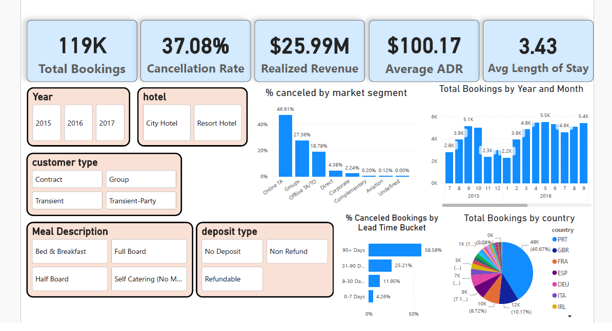

Content
This data set contains booking information for a city hotel and a resort hotel, and includes information such as when the booking was made, length of stay, the number of adults, children, and/or babies, and the number of available parking spaces, among other things.

All personally identifying information has been removed from the data.

Acknowledgements
The data is originally from the article Hotel Booking Demand Datasets, written by Nuno Antonio, Ana Almeida, and Luis Nunes for Data in Brief, Volume 22, February 2019.

The data was downloaded and cleaned by Thomas Mock and Antoine Bichat for #TidyTuesday during the week of February 11th, 2020.

# Hotel Booking Demand Analysis

## Data Cleaning (Power Query)
- **Missing Values:** Replaced `"NULL"` and `"NA"` in `agent`, `company`, and `children` with `0`, and imputed missing `country` values as `"Unknown"`.
- **Categories & Dates:** Merged `"Undefined"` meals into `"SC"` (Self Catering) and combined arrival year, month, and day into a single `arrival_date` column.
- **Anomalies:** Removed invalid bookings with `0` total guests.
- **Duplicates:** Retained consecutive identical rows because the dataset lacks a booking ID; identical rows in `Groups` and `Corporate` segments represent multi-room block bookings.

## Data Modeling & DAX
- Built a Star Schema connecting `hotel_bookings` to a `Calendar` table and `Meal_Lookup` table.
- Created DAX columns and measures for **Total Bookings**, **Cancellation Rate (%)**, **Realized Revenue**, **Average Daily Rate (ADR)**, and **Lead Time Buckets**.

## Key Insights
- **Revenue & Volume:** **[Total Bookings]** total bookings generated **\$[Realized Revenue]** in realized revenue at an average daily rate of **\$[Average ADR]**.
- **Cancellations:** Overall cancellation rate is **[Cancellation Rate]%**, with bookings made `90+ days` in advance canceling at the highest rate.
- **Seasonality:** Bookings and room rates peak in **[Peak Months, e.g., July–August]** and dip during winter.

## Project Files
- `data/raw/hotel_bookings.csv` — Original dataset
- `data/processed/hotel_bookings_clean.csv` — Cleaned dataset
- `dashboards/hotel_bookings_dashboard.pbix` — Interactive Power BI report
- `reports/figures/dashboard_preview.png` — Dashboard screenshot
